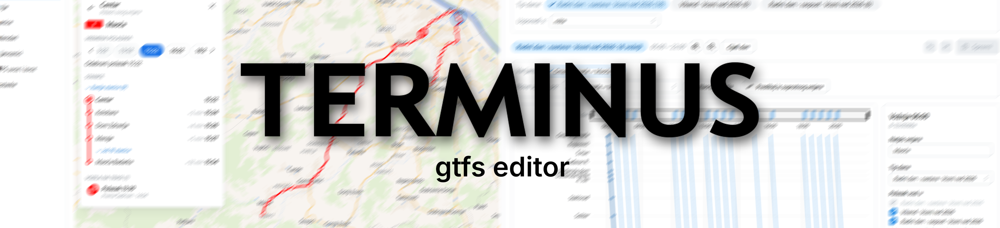
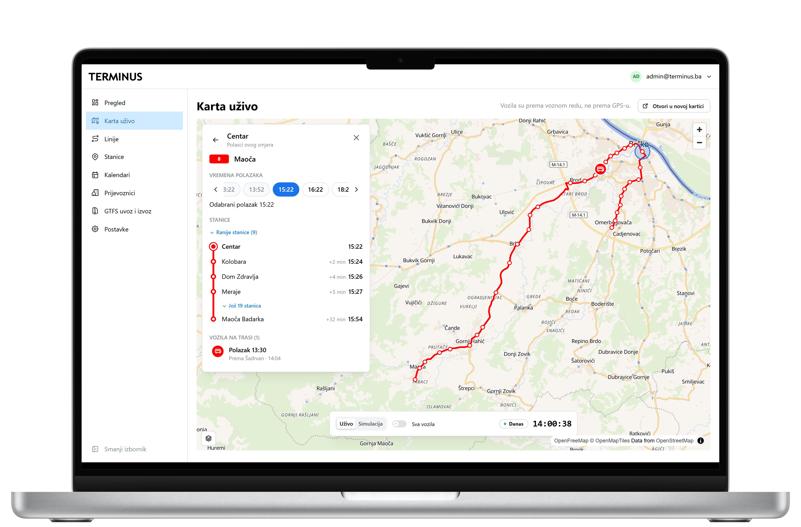
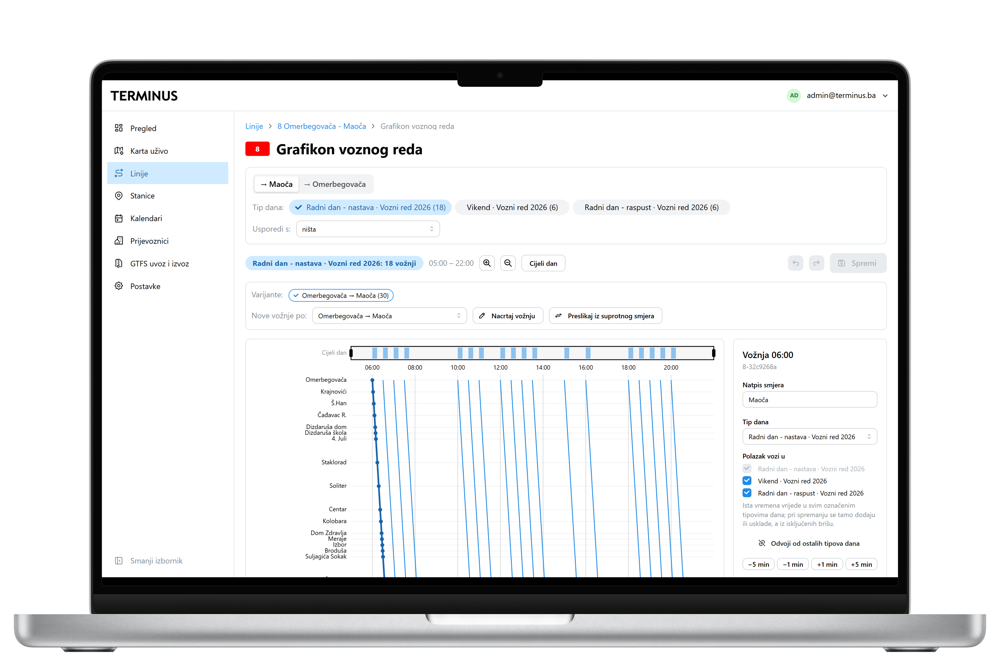
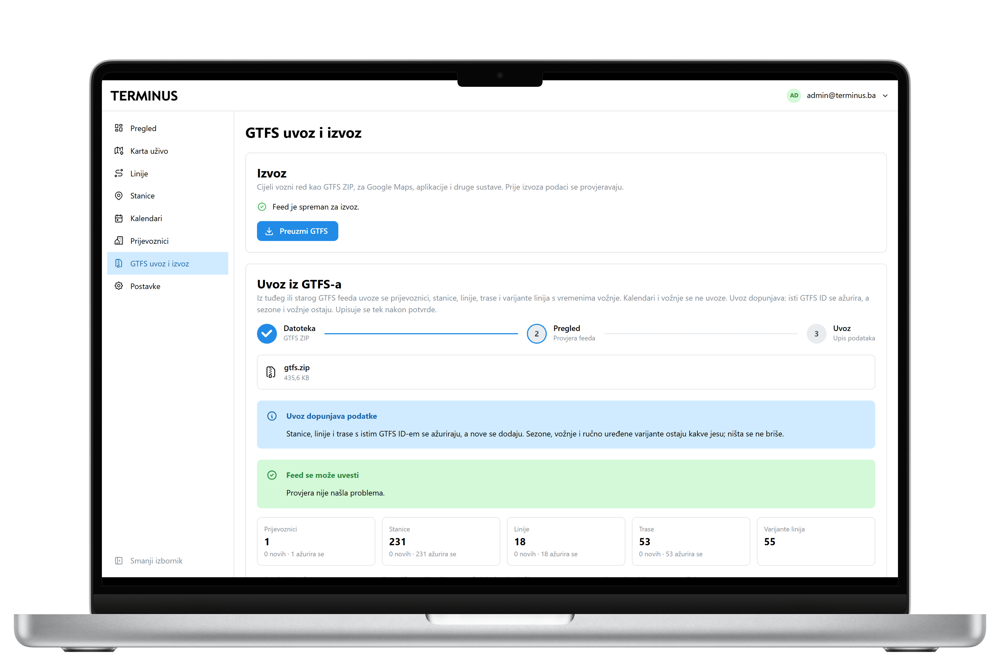
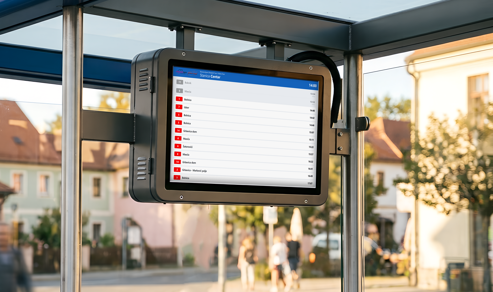

<p align="center">
  
</p>

<p align="center">
  Izrada, objava i prikaz voznih redova javnog prijevoza u formatu <a href="https://gtfs.org/">GTFS</a>.
</p>

<p align="center">
  <a href="https://github.com/to0ony/terminus/actions/workflows/ci.yml"></a>
  
  
  
  
  
</p>

---

Terminus je aplikacija u kojoj prijevoznik vodi stanice, linije, kalendare i
vožnje, iz njih izvozi GTFS feed za Google Maps i druge aplikacije, a putnicima
prikazuje polaske na zaslonima stanica, karti uživo i ispisanim voznim redovima.

Terminus je **single-tenant**: svaka tvrtka (npr. gradski prijevoznik) dobiva
vlastitu instancu i bazu. Unutar instance može postojati više prijevoznika
(GTFS `agency`), a svaka linija pripada jednom od njih.

## Snimke zaslona

**Dashboard**

<table>
  <tr>
    <td width="33%" valign="top">
      
      <br><sub><b>Karta uživo</b> – stanice, trase i vozila prema voznom redu</sub>
    </td>
    <td width="33%" valign="top">
      
      <br><sub><b>Grafikon voznog reda</b> – uređivanje vožnji linije</sub>
    </td>
    <td width="33%" valign="top">
      
      <br><sub><b>GTFS</b> – provjera podataka, uvoz i izvoz feeda</sub>
    </td>
  </tr>
</table>

**Na stanici**

<table>
  <tr>
    <td width="72%" valign="top">
      
      <br><sub><b>Zaslon polazaka</b> – sljedeći polasci za ekrane na stanicama i mobitele</sub>
    </td>
    <td width="28%" valign="top">
      
      <br><sub><b>PDF vozni red</b> – za ispis na stanicama</sub>
    </td>
  </tr>
</table>

## Mogućnosti

**Za prijevoznika**

- Stanice, linije i varijante uređuju se na karti; trase se crtaju po cestama
  i prugama iz OpenStreetMapa.
- Sezone voznog reda s tipovima dana, praznicima i raspustima, a vožnje se
  uređuju u grafikonu voznog reda.
- Uvoz postojećeg GTFS feeda i izvoz s provjerama, po izboru i kao javni feed.
- PDF vozni red stanice (A4 ili A3, hrvatski ili engleski) s QR kodom na
  zaslon stanice.
- Naziv, boje i logo prijevoznika na javnim stranicama i PDF-u.

**Za putnike**

- Zaslon polazaka za ekrane na stanicama i mobitele.
- Javna karta uživo s vozilima prema voznom redu.
- Javni API polazaka i GTFS feeda.

Što je u planu, vidi u [roadmapu](docs/roadmap.md).

## Tehnologije

| Dio | Tehnologije |
|---|---|
| Backend | ASP.NET Core Web API (.NET 10), Entity Framework Core 10, ASP.NET Core Identity |
| Baza | PostgreSQL |
| PDF | QuestPDF |
| Frontend | React 19, TypeScript, Vite, Mantine, TanStack Query, MapLibre GL |
| Testovi | xUnit (backend), Vitest (frontend) |
| CI | GitHub Actions |

## Struktura repozitorija

```
terminus/
├── backend/    .NET rješenje: Web API, servisi, pristup podacima, testovi
├── frontend/   dashboard, javni zaslon stanice i karta (React)
└── docs/       dokumentacija
```

## Brzi početak

Preduvjeti: [.NET 10 SDK](https://dotnet.microsoft.com/download),
PostgreSQL 13+, `dotnet-ef` i [Node.js](https://nodejs.org) 22+.

```sh
cd backend
dotnet user-secrets set "ConnectionStrings:Default" "Host=localhost;Database=terminus;Username=postgres;Password=<lozinka>" --project Terminus.WebApi
dotnet user-secrets set "Admin:Email" "admin@example.com" --project Terminus.WebApi
dotnet user-secrets set "Admin:Password" "<barem 10 znakova>" --project Terminus.WebApi
dotnet ef database update --project Terminus.DAL --startup-project Terminus.WebApi
dotnet run --project Terminus.WebApi --launch-profile http   # http://localhost:5183
```

```sh
cd frontend
npm install
npm run dev    # http://localhost:5173
```

Nakon prijave čarobnjak nudi uvoz GTFS-a ili početak od nule. Konfiguracija,
testovi i migracije opisani su u [lokalnom razvoju](docs/development.md).

## Dokumentacija

| Dokument | Sadržaj |
|---|---|
| [Roadmap](docs/roadmap.md) | stanje, faze razvoja i otvorena pitanja |
| [Lokalni razvoj](docs/development.md) | postavljanje, konfiguracija, testovi, migracije |
| [Arhitektura](docs/architecture.md) | backend slojevi, tok zahtjeva, obrada grešaka |
| [Frontend](docs/frontend.md) | stranice, struktura, rute i pozivi API-ja |
| [API](docs/api.md) | prijava, endpointi, javni API, greške |
| [Model podataka i GTFS](docs/data-model.md) | tablice, podržana GTFS polja, pravila |
| [GTFS uvoz](docs/gtfs-import.md) i [izvoz](docs/gtfs-export.md) | izvještaj, provjere, sadržaj feeda |
| [Polasci, zaslon i PDF](docs/departures-and-timetables.md) | izračun polazaka, zaslon na stanici, PDF vozni red |
| [Shema baze](docs/terminus_schema.sql) | SQL shema s komentarima |
